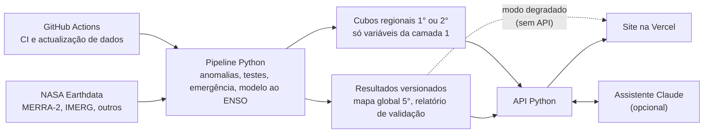

# 04. Arquitectura

## Diagrama

Resumo: o **pipeline** calcula offline e escreve ficheiros; a **API** serve esses ficheiros e calcula regiões à pedido a partir dos cubos; o **site** mostra. Se a API falhar, o site continua com os resultados do mapa global em ficheiros estáticos.

## Componentes

| Componente | Pasta | Responsabilidade | Dono |
| --- | --- | --- | --- |
| Pipeline | `pipeline/` | Leitores, anomalias, tendência e testes, emergência, modelo ao ENSO, exportação | Agente Pipeline |
| Validação | `validation/` | Teste retrospectivo, fragilidade, teste nulo, verificações cruzadas | Agente Ciência |
| API | `api/` | Rotas de resultados, região, "o que está a mudar", ferramentas do assistente | Agente Backend |
| Site | `web/` | Percurso do Detetive, mapas, modos de público, apresentação | Agente Front-end |
| Assistente | `assistant/` | Instruções, ferramentas e avaliação do assistente (opcional) | Agente Assistente |
| Documentos | `docs/` e `specs/` | Especificações, método, documentação | Agentes Especificações e Documentação |
| Automação | `.github/` e `.claude/` | CI, actualização de dados, regras e agentes | Agente DevOps |

O backend **importa** o pacote do pipeline para calcular regiões; não reescreve o cálculo. Há um só sítio onde cada fórmula vive.

## Contratos de dados

- Cada ficheiro tem `schemaVersion`; o site valida tudo à entrada (esquema) e recusa o que não bate.
- O manifesto lista as variáveis com unidades, fonte, resolução, período e o rótulo **`real`** ou **`demonstração`**.
- Os esquemas da API geram o contrato OpenAPI; o cliente do site é gerado a partir dele (B02), para o site e a API não divergirem.
- Valores em falta são `null`, nunca zero.

## Rotas da API (rascunho, a fechar nas specs)

| Rota | Faz | Item |
| --- | --- | --- |
| `GET /variaveis` | Manifesto de variáveis | B03 |
| `GET /variaveis/{id}/mapa?preset=&enso=` | Mapa a 5° pré-calculado para um período predefinido, com ou sem ajuste ao ENSO (também existe como ficheiro estático) | B04 |
| `GET /variaveis/{id}/mapa/calculo?inicio=&fim=&enso=` | Mapa a 5° **recalculado** para um período livre; cache, fila, tempo máximo | B18 |
| `GET /variaveis/{id}/serie` | Série global ou de uma região-exemplo | B04 |
| `POST /regiao/analise` | Polígono GeoJSON **ou** `globo`, variável, período, meses opcionais (lista de 1 a 12; fórmula 17): devolve série, tendência, testes, projecção | B08 |
| `POST /regiao/o-que-muda` | Polígono e período: tabela de todas as variáveis reais | B14 |
| `GET /validacao` | Relatório de validação | B09 |
| `POST /assistente/pergunta` | Conversa com ferramentas (opcional) | B11 |

Limites em todas as rotas de cálculo: tamanho do polígono, número de pedidos, tempo máximo e mensagens de erro claras.

## Capacidade do servidor (2 vCPU e 1 GB de RAM por instância)

**Medição de referência (feita ao desenhar este plano, não no hospedeiro real):** em Python com NumPy, num só núcleo de uma máquina de teste, o Theil-Sen, o S de Mann-Kendall e o factor de Hamed-Rao para as 2 592 células de 288 meses levaram cerca de **2,7 s**, com pico de memória de cerca de **12 MB** quando as células são processadas em blocos de 16. Não incluem as anomalias, o ajuste ao ENSO nem o FDR (baratos, mas não medidos), nem foram comparados com `scipy` e `pymannkendall`. Com um valor por ano (24 pontos) o mesmo cálculo levou cerca de 0,02 s. **O número que conta é o do hospedeiro escolhido (D4);** a SPEC-130 fixa o limiar depois de o medir.

Desenho para caber em 1 GB:

- **Cubos em memória mapeada** (`numpy.load(..., mmap_mode="r")`): processos da mesma instância partilham as páginas. Os cubos a 1° das 3 variáveis da camada 1 somam cerca de 225 MB; o a 5° pesa cerca de 3 MB por variável.
- **Um cálculo pesado de cada vez por processo** (semáforo), em blocos de células, para o pico de memória ficar previsível. Com 2 vCPU, no máximo 2 recálculos em simultâneo por instância; os outros esperam na fila ou recebem "ocupado" com a sugestão dos períodos predefinidos.
- **Cache por combinação de pedido**, com tecto de memória, e cabeçalhos HTTP de cache (`Cache-Control`, `ETag`) para a rede de entrega do hospedeiro ou da Vercel guardar as respostas (a confirmar o que o plano escolhido permite).
- **Várias instâncias:** sem estado, atrás de um balanceador; cada instância tem os cubos na imagem ou no arranque. A cache em memória é por instância; por isso os períodos predefinidos saem dos ficheiros estáticos e não de cálculo.
- **Limites:** pedidos por origem, tamanho do polígono, tempo máximo por pedido, mensagens de erro claras.
- **Teste de carga** antes do Gate 2 (ver `09`): N pedidos em simultâneo, memória abaixo do tecto, nenhum pedido sem resposta.

## Mensagens e idiomas

A API **não devolve frases** em nenhum idioma: devolve `chave` e `parametros` (por exemplo, a chave da explicação e os números); o site traduz com o catálogo do idioma escolhido (SPEC-140). Assim, trocar de idioma não pede nova chamada e os números ficam iguais em todas as línguas.

## Segurança

- Credenciais da NASA, chaves do fornecedor de IA (Groq ou OpenRouter) e outros segredos só nos cofres do GitHub, da Vercel e do hospedeiro. Nomes das variáveis de ambiente: `EARTHDATA_USERNAME`, `EARTHDATA_PASSWORD`, `GROQ_API_KEY`, `OPENROUTER_API_KEY`, `NEXT_PUBLIC_API_URL` (só o nome; nunca o valor num ficheiro).
- CORS restrito ao domínio do site; limites de pedidos; validação de todas as entradas.
- O texto que vem de utilizadores, de ficheiros ou de páginas web é **dado**, nunca instruções para um agente ou para o assistente.
- Nada de dados pessoais nos registos.

## Modo degradado

Se a API falhar, o site mostra os últimos resultados pré-calculados do mapa global, avisa o utilizador, e desactiva a análise de região desenhada, o "o que está a mudar aqui?" e o assistente (B07). O modo apresentação e as regiões-exemplo continuam a funcionar porque os seus dados são estáticos.

## Opções de stack (D2 e D3)

| Parte | Opção A (proposta de um colega) | Opção B (já usada antes) | Nota |
| --- | --- | --- | --- |
| Site | Next.js e React | TanStack Start e React | A Vercel suporta as duas |
| Mapa | Leaflet (clicar, desenhar, zoom) | d3-geo com projecção Equal Earth | Leaflet facilita desenhar regiões; a projecção Equal Earth dá uma visão global mais justa. MapLibre é uma terceira via |
| Gráficos | A escolher | Recharts | Qualquer um serve |
| API | FastAPI | Django Ninja | Ambos geram OpenAPI |
| Testes | pytest e Vitest ou equivalente | pytest e Vitest | Os mesmos |

**Critério de decisão:** a stack que a pessoa responsável domina e consegue rever depressa. A inclinação por Next.js, Leaflet e FastAPI é pela interacção e pela simplicidade de uma API só de leitura e cálculo, e **não é uma imposição**.

## Deploy

- Site: Vercel, com pré-visualização em cada pull request (D05).
- API: hospedeiro por escolher (D4), com rota de saúde e variáveis de ambiente (B06).
- Dados: os ficheiros do mapa global vão no repositório ou num armazenamento estático; os cubos regionais ficam no hospedeiro da API.
- Actualização de dados: GitHub Action manual primeiro e mensal depois, que abre um pull request; só se liga depois de a Fase 1 correr à mão sem erros (D06).
